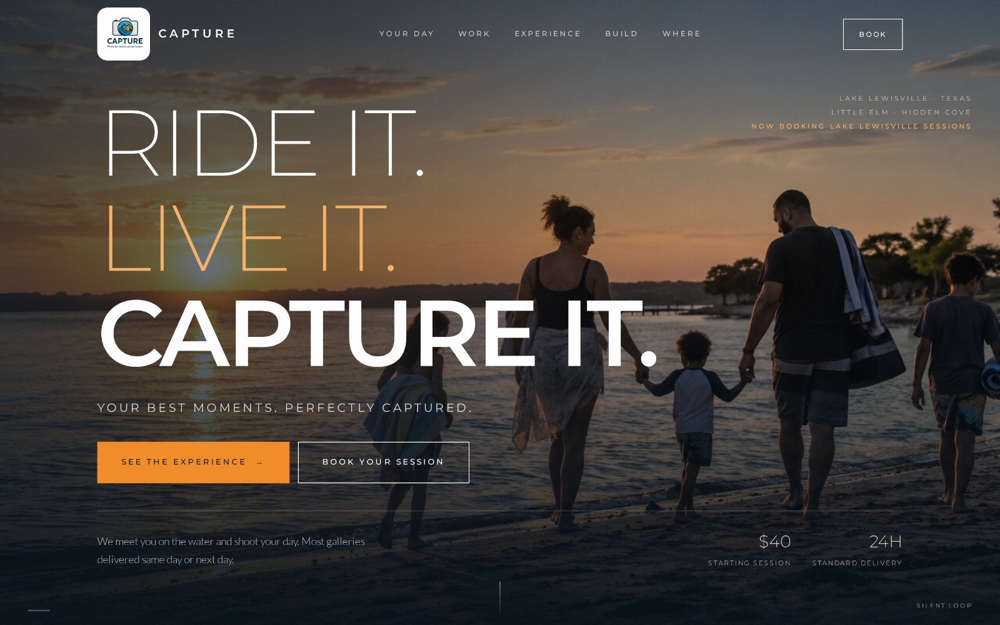
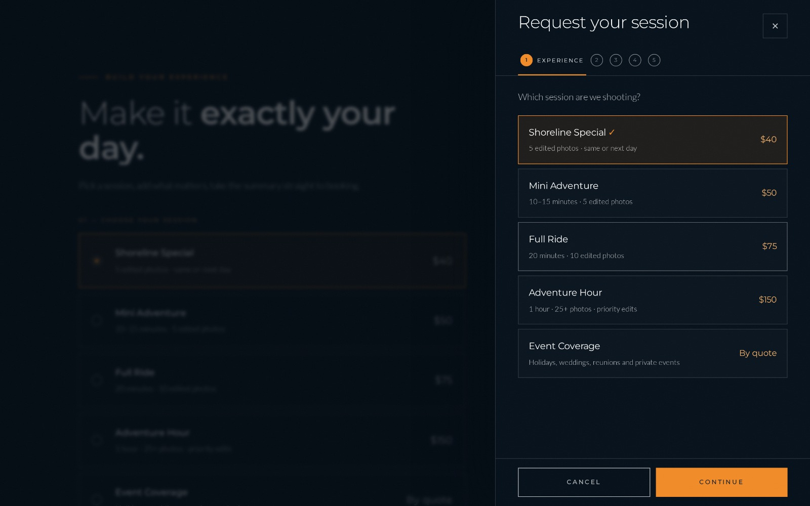
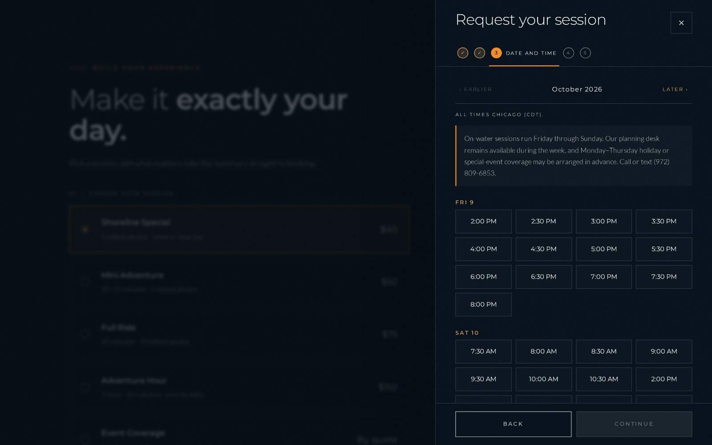
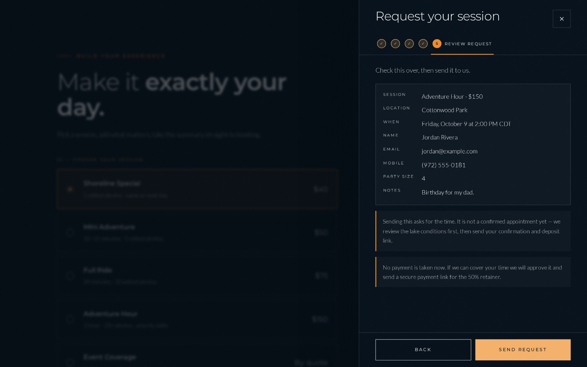
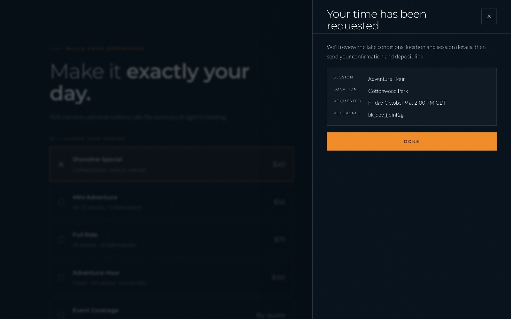
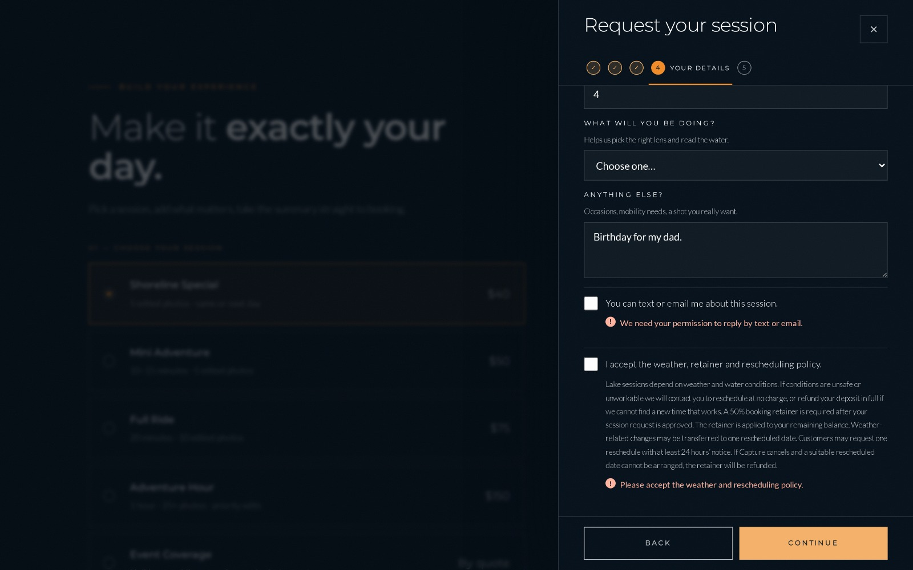
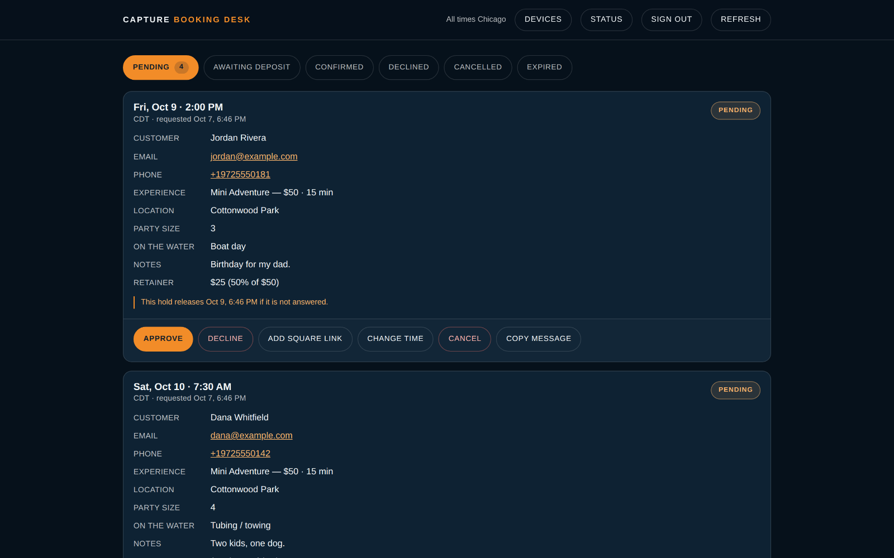
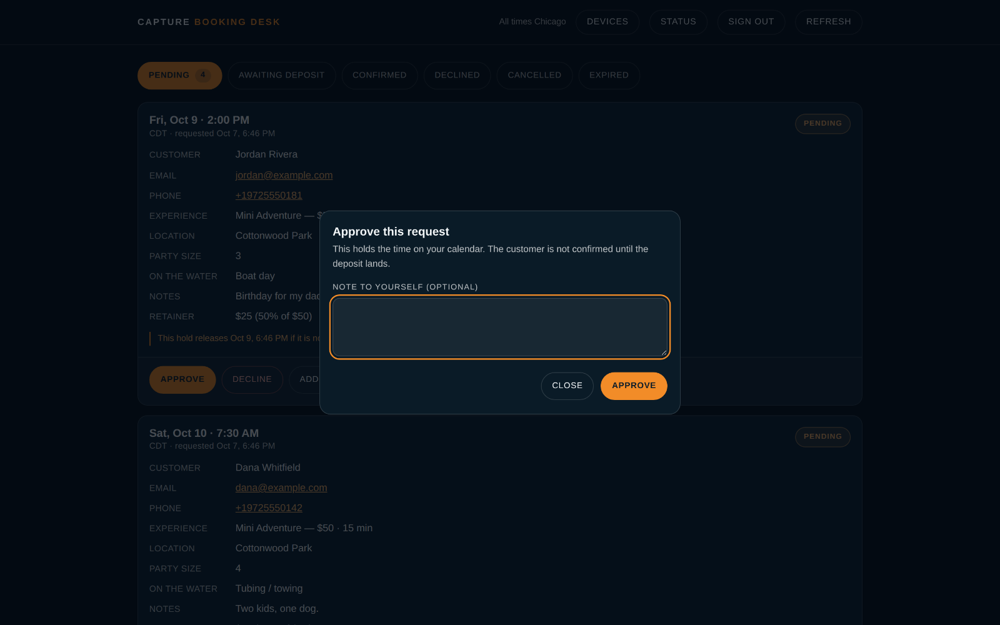
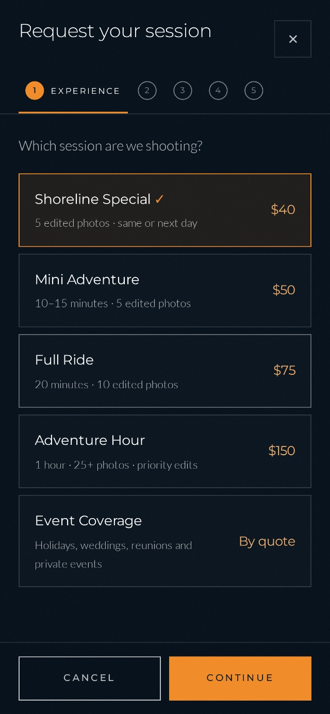

# Capture — booking and operations system for a lakefront photography business

**A case study in running a product end to end: defining the operating rules, building the system with AI assistance, deploying it, and debugging it in production.**

Capture Media Group photographs people on Lake Lewisville, Texas — boat days,
tubing runs, family shoreline sessions, sunset portraits. This repository
documents the booking and operations system built to run it.

> **Role:** product owner and operator — Jeremy Dees
> **Build method:** AI-assisted development (Claude Code)
> **Status:** live in production; several items still in flight, listed honestly at the bottom



---

## The business problem

Bookings arrived as direct messages, texts and comments. That created four
operational failures that had nothing to do with photography:

| Problem | Operational cost |
|---|---|
| No single source of availability | Double-bookings, and sessions accepted that could not physically be reached in time |
| No defined service catalogue | Every enquiry renegotiated price and duration from scratch |
| No deposit step | Work was blocked out for people who never paid and sometimes never showed |
| No record of a request's state | "Did I reply to that one?" answered by scrolling three apps |

The system below exists to make each of those a defined step instead of a
judgement call made from a phone at the boat ramp.

---

## My role

I am not a software engineer. I own this product and operate it.

**What I did:**

- **Defined the operating model** — the service catalogue, session durations,
  travel and setup buffers, which days are open to online booking, how far
  ahead a customer may book, and how close to the session they still can.
- **Set the commercial rules** — a 50% retainer, a fresh payment link per
  approved booking, and a custom-quote path for event coverage.
- **Built the infrastructure myself** — created the production database,
  the hosting project, the encrypted secret storage and the service bindings.
- **Directed the build** — specified each release, reviewed what came back,
  approved or rejected it before anything merged or deployed.
- **Tested it on real devices** and reported the defects I found, including
  two that automated tests had passed over and one that only appears in Safari.
- **Cut scope deliberately** when expanding it would have shipped a known
  operational defect.

**What I did not do:** write the implementation code. Claude Code wrote it,
from my specifications, under my review. That division is the point of this
case study — I treated an unfamiliar technology stack the way I would treat
any unfamiliar operation: learn the constraints, define the process, direct
the work, verify the result, and own the outcome.

---

## What the system does

### Customer-facing booking

A five-step scheduler on the public site. Each step validates before it will
advance.

| Step | What it does |
|---|---|
| 1. Session | Five packages, each with a fixed duration and price — or a custom quote for events |
| 2. Location | Named shooting locations, plus a free-text option that becomes required if chosen |
| 3. Time | Only genuinely open times, computed server-side against the live calendar |
| 4. Details | Contact details, party size, activity, notes, and two explicit consents |
| 5. Review | A plain statement that this is a *request*, not a confirmed appointment |

<p align="center">
  
  
</p>

Nothing is accepted that cannot be honoured. If the calendar connection is not
configured, the scheduler says so plainly and refuses to take a booking rather
than storing one it cannot fulfil.

The final step states plainly that this is a request, not a confirmed
appointment — and the confirmation repeats it, because the single most
expensive misunderstanding in this business is a customer who believes a time
is locked when it is not:

<p align="center">
  
  
</p>

**Validation is a workflow control, not a formality.** Consent to be contacted
and acceptance of the weather and rescheduling policy are both required, and
the form says exactly what is missing:



### The booking desk

A private operations view. Six queues reflect the real lifecycle of a job:

**Pending → Awaiting deposit → Confirmed**, with **Declined**, **Cancelled** and
**Expired** as terminal states.



Each card carries everything needed to make the decision without opening
anything else: the customer, the session, the location, the party size, what
they will be doing on the water, their notes, the retainer owed, and when the
hold releases if the request goes unanswered.

The actions are the workflow: **Approve · Decline · Add payment link · Change
time · Cancel · Copy message**.



Approving holds the time on the calendar. It does **not** confirm the customer
— that happens when the deposit lands. That separation was a deliberate
operating decision, not a technical one.

### Automatic notification

When a request is stored, an email goes to the owner immediately — a request is
waiting. Nothing is ever emailed to the customer automatically; every customer
message is sent by a person, from a prepared draft.

If the email provider is unreachable, **the booking is still saved** and the
failure is written to an audit log. A notification problem never costs a
customer their slot.

### Deposit workflow

A 50% retainer on every approved booking, as a payment link generated per
booking. Event coverage takes 50% of the agreed quote. The desk calculates and
displays the retainer on the card.

### Mobile

The whole system is used from a phone at the lake, so it was built and tested
at phone width throughout.

<p align="center">
  
  
</p>

---

## Technology

Only what is actually in the production repository.

| Layer | Technology |
|---|---|
| Hosting | Cloudflare Pages |
| Backend | Cloudflare Pages Functions (serverless) |
| Database | Cloudflare D1 (SQLite at the edge) |
| Calendar | Google Calendar API via a service account, free/busy only |
| Email | Resend transactional email API |
| Admin sign-in | WebAuthn passkeys (Face ID / Touch ID) |
| Spam control | Cloudflare Turnstile (optional) |
| Front end | Hand-written HTML/CSS/JS, GSAP 3.15 for motion, Three.js for one 3D feature |
| Testing | Playwright, plus Node-based suites running the real functions against real SQLite |

**Scale:** ~6,800 lines of application and test code across the backend
functions, shared libraries, front-end modules and the test tooling.

---

## Architecture

Full write-up: **[docs/architecture.md](docs/architecture.md)**

```
  Customer                          Owner
     │                                │
     ▼                                ▼
┌──────────────────┐         ┌──────────────────┐
│  Public site     │         │  Booking desk    │
│  5-step booking  │         │  6 queues        │
└────────┬─────────┘         └────────┬─────────┘
         │                            │  passkey sign-in
         ▼                            ▼
   ┌─────────────────────────────────────────┐
   │        Serverless API at the edge        │
   │  validate → rate-limit → check calendar  │
   │  → re-check the slot → store → notify    │
   └───┬──────────────┬───────────────┬───────┘
       ▼              ▼               ▼
   ┌────────┐   ┌───────────┐   ┌──────────┐
   │  SQL   │   │  Calendar │   │  Email   │
   │   DB   │   │ free/busy │   │ provider │
   └────────┘   └───────────┘   └──────────┘
```

Two design decisions worth naming:

**The operating rules live in one file.** Services, durations, buffers,
opening hours, notice period, booking window and deposit policy are defined
once and read by the public scheduler, the availability engine and the booking
desk. Changing a price or an opening time is a single edit that cannot leave
two parts of the system disagreeing. That is standardisation applied to code.

**Availability is decided on the server, twice.** Once to show the times, and
again at the moment a request is submitted. The second check is what stops two
customers claiming one slot while both have the page open.

---

## Problems solved

These are real incidents from this project, each with the root cause.

### 1. Notifications silently did nothing in production

**Symptom:** bookings saved correctly; the owner notification never arrived.
Local tests passed.

**Root cause:** the code read a secret under one name while the setup
documentation instructed creating it under a different name. The value existed
— under a name nothing read.

**Fix:** a diagnostic endpoint that reports *which configuration name is
missing*, as a name only, never a value. Turning an invisible failure into a
named one is the whole fix; the code change that followed was two lines.

**Operational parallel:** a process that fails silently is worse than one that
fails loudly. Build the check that names the gap.

### 2. The retainer overcharged by fifty cents

**Symptom:** a $75 session showed a $38 retainer.

**Root cause:** 50% was being calculated in whole dollars, so $37.50 rounded
up.

**Fix:** calculate in cents, round once at display.

**Operational parallel:** small arithmetic errors in a billing step become
customer trust problems. They are worth finding before a customer does.

### 3. A panel appeared empty

**Symptom:** a status panel in the booking desk showed only its last line.

**Root cause:** two independent causes stacked. Opening the panel moved the
cursor into a read-only field, which scrolled it to the bottom; and a styling
rule meant to give the panel height was being overridden by a more specific
rule elsewhere.

**Fix:** focus a field the user can actually type in, and make the sizing rule
specific enough to win.

**Operational parallel:** I reported this from my own device after the
automated tests passed. Tests check what you thought to ask. Using the thing
yourself checks what you didn't.

### 4. Secure admin access without a paid plan

**Symptom:** the intended access-control product required billing details to
activate, even on its free tier.

**Decision:** reject it and use WebAuthn passkeys instead — Face ID or Touch ID
on enrolled devices, with a second-device enrolment path. No ongoing cost, and
a stronger authentication factor than a password.

**Operational parallel:** a constraint is not automatically a blocker. The
second option was cheaper *and* better.

### 5. A browser-specific failure still open

**Symptom:** the live homepage repeatedly crashes in Safari on macOS.

**Status:** unresolved. Five subsystems could each cause it and they share a
page, so rather than guess, the page now accepts URL switches that disable each
one individually — turning a coin-flip into a measurement taken on the machine
that can actually reproduce it.

**Operational parallel:** when you cannot reproduce a fault, instrument it so
the person who can will produce the evidence.

### 6. Tests that stopped testing anything

**Symptom:** three test suites began failing with no code change.

**Root cause:** they contained fixed calendar dates. Once the real date passed
them, every date fell outside the booking window and the suites were asserting
against empty results — and had been silently weakening for some time before
they failed outright.

**Fix:** all windows measured relative to the current date.

**Operational parallel:** a control that quietly stops working is more
dangerous than one that is obviously broken.

---

## How it was built and released

Every change followed the same route:

```
specify → branch → build → automated tests → preview → review on a real device → approve → merge → deploy
```

**Deliberate practices:**

- **Nothing merges or deploys without explicit approval.** Several releases sat
  on a branch for days while I verified them.
- **One concern per release.** A display fix and a visual update are separate
  branches, so a problem with either can be reverted without losing the other.
- **The build publishes from an allow-list.** The deployment tool copies only
  files named as publishable and refuses to finish if backend code appears in
  the output. Secrets cannot be deployed by accident because the build will not
  carry them.
- **Secrets never touch the repository.** Configuration files list variable
  *names* with empty values; real values live only in encrypted storage.
- **Blocked work is recorded, not guessed at.** A running document tracks what
  is done, decided, deferred and blocked, and *what specifically is needed* to
  unblock each item.

**Test coverage:** nine automated suites, 461 checks, all passing — availability rules and
timezone handling including daylight-saving transitions, the full booking flow
in a browser, the booking desk's six queues and every action, passkey
enrolment and sign-in with real cryptographic signatures, email notification
including its failure paths, and the public site at three screen widths and
under reduced-motion settings.

---

## Operational Mindset

This project is a software artifact, but the work was operations work.

**Process design.** I did not start with a booking form. I started with the
constraints: how long each session actually takes, how long it takes to get
across the lake between them, which days are realistically workable, and how
much notice makes a booking achievable. The software encodes that operating
model. The five-step flow exists because those are the five decisions that must
be made in that order.

**Workflow optimisation.** Six queues, not a list. Each card carries every
field needed to decide, so a decision never requires opening a second system.
The actions on a card are the actual next steps. The goal was to make the
correct action the easiest one.

**Root-cause problem solving.** Each incident above was traced to a cause and
fixed there. When notifications failed, the fix was not "resend the email" —
it was making the system name the missing configuration. When a test suite
broke, the fix was not changing the assertion to pass.

**Standardisation.** One file defines every operating rule. One build process
decides what is publishable. One release route for every change. Standardising
the boring parts is what makes the exceptions visible.

**Continuous improvement.** Seven releases, each reviewed on a real device
before approval. Defects I found in use went back in as fixes with their root
cause recorded, so the same class of problem is recognisable next time.

**Adaptability.** I had not used any of this stack before starting. I learned
what I needed to make decisions — enough about scheduling logic to define
buffers correctly, enough about authentication to choose passkeys over a paid
product, enough about deployment to configure the infrastructure myself, and
enough about debugging to diagnose problems rather than just report them. I
used AI assistance deliberately: it wrote the code, I owned the specification,
the review, the testing and the outcome.

**Judgement about scope.** The clearest example: I asked for two additional
lakes to be added as bookable locations. The analysis showed that travel
allowances were defined per *service*, not per *location*, so adding sites
35–40 miles away would let the system sell two sessions I could not physically
get between. I deferred the feature rather than ship a scheduling defect, and
recorded exactly what it needs. Shipping something broken is not delivery.

---

## Current status

Honest state as of October 2026.

| | |
|---|---|
| **Live** | Public site, five-step booking, availability engine, booking desk with all six queues, passkey sign-in, calendar integration, owner notification |
| **In progress** | Full payment-link-to-confirmation flow not yet verified end to end in production |
| **Open** | A Safari-specific page failure on macOS, instrumented and under investigation |
| **Blocked on assets** | Hero video sequence — the system is built and waiting on the footage |

---

## About this repository

This is a **case study**, not the product source. The production repository is
private and stays private: it contains backend code, authentication
implementation, customer data structures, infrastructure identifiers and
operational configuration, none of which belongs in public.

Everything described here is supported by that repository. No technology is
claimed that is not in use, and no contribution is claimed that was not made.

**Jeremy Dees** — product owner and operator, Capture Media Group
